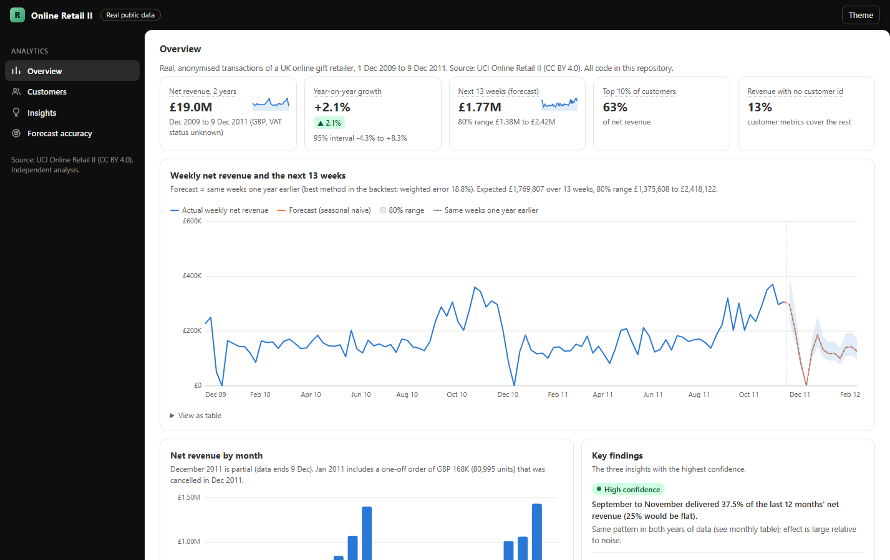

# Online Retail II: insights and backtested forecasts on real transactions

A reproducible analytics pipeline on **real, anonymised transactions** of a UK online gift retailer (1 Dec 2009 to 9 Dec 2011, about 1 million order lines). It cleans the data with every rule logged, computes e-commerce metrics (RFM segments, cohort retention, product concentration, bundles, returns), turns them into **plain-language insights with evidence, confidence and a suggested action**, and produces **forecasts whose past accuracy is measured**.

**Live report:** https://corgi-coder99.github.io/Online-Retail-Insights/ (single file, light and dark theme, works on phone and desktop)



Open `report/index.html` in a browser (single file, works offline, light and dark theme, tooltips).

## What you get

| Output | Where |
|---|---|
| Interactive report | `report/index.html` |
| 13 generated insights (evidence, confidence, caveat, action) | `outputs/insights.md`, `outputs/insights.json` |
| Every cleaning rule with rows and GBP affected | `outputs/cleaning_log.md` |
| Forecast, backtest and customer-model results | `outputs/forecast.json`, `outputs/customer_model.json`, `outputs/tables/` |
| Recommendations for the business (one page) | `docs/recommendations.md` |
| Methodology, definitions and limits | `docs/METHODOLOGY.md` |

## Headline numbers

- Net revenue **GBP 19.0M** over two years; year-on-year growth **+2.1%** (95% interval -4.3% to +8.3%).
- **September to November = 37.5%** of the last 12 months' revenue; the top 10% of customers bring **63%** of net revenue.
- **13.1%** of sales revenue has no customer id, so customer metrics cover 86.9% of revenue.
- Forecast for the 13 weeks from 5 Dec 2011: **GBP 1.77M** (80% range 1.38M to 2.42M). Method: same weeks one year earlier, because in a rolling backtest it was as good as the regression and ensemble models (weighted error 18.8%).

## Honest forecasting

- Forecasts are judged on past data first. A complex model is used only if it beats the simple one by at least 2 percentage points; here none did, so the simple one is used.
- The customer model (will a customer buy again in 180 days, and how much) was validated on a later period it never saw. It ranked customers about as well as "recent activity" and over-predicted the total by 36%. The report says so, gives a corrected range, and tells readers to use segment totals, not individual probabilities.
- Growth was deliberately not added to the revenue forecast: in the backtest, adding it made errors larger.

## Data

Chen, D. (2012). *Online Retail II* [Dataset]. UCI Machine Learning Repository. DOI 10.24432/C5CG6D. Licensed CC BY 4.0. Customer ids are anonymised in the source. The raw file is **not** stored in this repository; `pipeline/download.py` fetches it and checks its SHA-256. No customer-level table is published: all outputs are aggregates (the test suite checks this).

Things the source does not say, and this project does not assume: the VAT treatment of prices, and whether missing customer ids are guests or marketplace orders.

Data quirks found and handled (details in `outputs/cleaning_log.md`):
- The two Excel sheets **overlap on 1 to 9 Dec 2010**: 22,523 rows appear twice (verified row by row) and the copy is dropped.
- Postage, manual entries, bank and marketplace fees, adjustments, test items and gift vouchers (5,832 lines) are not products and are kept apart.
- 17,973 cancellation lines are treated as returns; 5,972 product lines with zero or negative price are excluded from sales.
- One order of 80,995 units (GBP 168K, Jan 2011) was cancelled in Dec 2011; it is excluded from the forecast series and from product statistics, and flagged.

## Run it

```bash
pip install -r requirements.txt        # pandas, duckdb, openpyxl, scipy, scikit-learn, statsmodels
python -I pipeline/run_all.py          # download, ingest, clean, metrics, forecast, customer model, insights, report
python -I tests/test_pipeline.py       # 15 checks
```

The first run reads a 45 MB Excel file (a few minutes). Everything runs locally in DuckDB; no server is needed.

## Structure

```
pipeline/download.py        fetch and verify the dataset
pipeline/ingest.py          Excel -> DuckDB (raw)
pipeline/clean.py           cleaning rules + cleaning_log
pipeline/metrics.py         monthly, weekly, RFM, cohorts, products, bundles, countries
pipeline/forecast.py        weekly revenue forecast, rolling-origin backtest, 80% range
pipeline/customer_model.py  180-day purchase and spend model with time-based validation
pipeline/insights.py        evidence -> insight statements with confidence and caveats
pipeline/report.py          single-file HTML report
tests/test_pipeline.py      sanity checks
```

## Limits

Two years is one Christmas season per year: seasonal conclusions are strong, trend conclusions are weak. This is a trade-oriented gift business, so concentration and basket patterns do not describe consumer retail. The 2009 to 2011 data says nothing about today's market. Associations (for example bundles) are not causal.

Related project: [Lumi-Ecommerce-Dashboard](https://github.com/Corgi-coder99/Lumi-Ecommerce-Dashboard), a simulated French multi-channel store with a MySQL star schema and dashboard.

## License

Code: MIT (see `LICENSE`). Data: CC BY 4.0, see the citation above.
